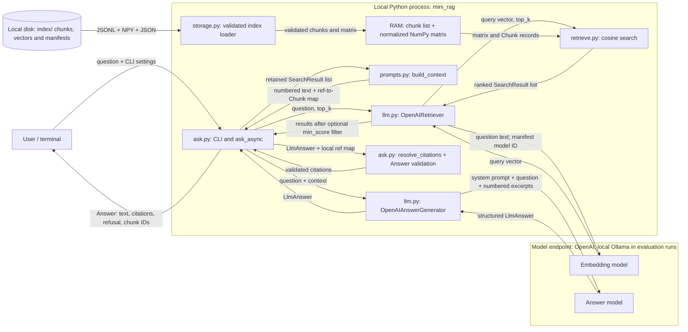
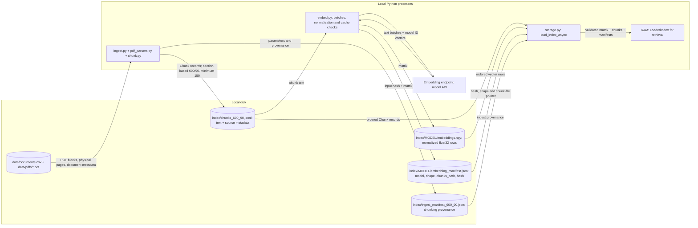
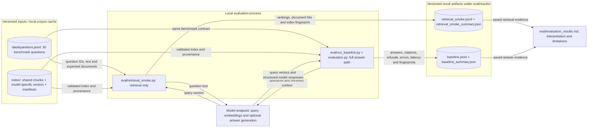
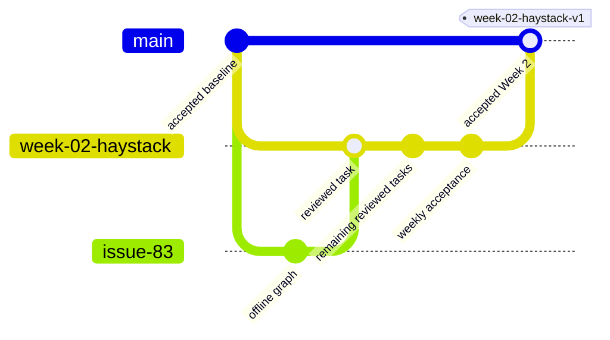

# mini-rag

A plain-Python RAG over IPCC PDFs. The week-1 implementation is the reference
for the Haystack comparison in week 2. See [evaluation results](eval/evaluation_results.md)
for measured results and known limitations.

Week 2 design: [component map and migration decisions](docs/haystack-component-map.md)
and [planned indexing/query pipelines](docs/haystack-pipelines.md). These describe
the agreed Haystack port, not a completed replacement for the runtime below.

## How the current system works

These diagrams describe the implemented plain-Python system, not a task order.
Arrows name the data exchanged. Boxes inside a boundary share a location;
cylinders are files on disk. Haystack is planned for week 2, not part of this
runtime yet.

### Components and connections



Retrieval and citation resolution are local Python operations, not model calls.
The model receives numbered excerpts including source labels; it returns reference
numbers, not authoritative source metadata. `resolve_citations` copies document
IDs and inclusive physical page ranges from the local `Chunk` records. Unknown
references raise an error. An empty retained result list returns a local refusal
without an answer-model call; query embedding still requires the embedding endpoint.
The CLI renders Rich output or emits `Answer` JSON with `--json-output`.

### Where corpus information lives



`MODEL` is a portable directory name such as `text-embedding-3-small`; API model
IDs retain their original spelling. Matrix row `i` belongs to chunk `i`.
The loader validates the chunk hash, vector dtype/shape and row count and loads
the adjacent ingest manifest. A valid unchanged embedding cache avoids document
embedding calls. PDFs, indexes and logs are local ignored artifacts, not GitHub
storage. There is no separate vector database in the current implementation:
search uses the matrix loaded into the Python process.

### Evaluation data and stored evidence



The report is maintained from saved evidence; it is not automatically produced
by the baseline script. Document hits measure source-document matches, not answer
correctness or passage relevance. Baseline output refuses accidental overwrites;
use a new directory for a new experiment. Offline tests use fake clients, while
live evaluation makes model calls. See the commands below for exact paths and flags.

## Running the project

> [!NOTE]
> `ingest`, `embed`, `retrieve`, `display`, and `ask` are implemented.
> The complete answer pipeline (structured generation, citation resolution and
> orchestration), retrieval smoke evaluation and end-to-end baseline are implemented.
> Run the following commands from the repository root, in pipeline order.

### 1. Set up the environment

The project supports Python 3.12 and 3.13 (`>=3.12,<3.14`) and uses Python 3.13.15 for
local development. PyMuPDF has compatibility issues with Python 3.14, so
Python 3.14 is not currently supported.

```bash
pyenv install -s 3.13.15
pyenv local 3.13.15

python -m pip install --upgrade pip
python -m pip install -e ".[dev]"
```

### 2. Verify the installation

```bash
python --version
python -c "import mini_rag; print('The mini_rag package works')"
```

Expected output:

```text
Python 3.13.15
The mini_rag package works
```

Ruff and mypy target Python 3.12, the minimum supported version. Run the
lint check with:

```bash
python -m ruff check .
```

### Run the embedding tests

```bash
python -m pytest tests/test_embed.py
```

Async tests run automatically with `pytest-asyncio`, included in the dev
dependencies. The embedding tests use a fake client and make no API calls.

Logging is configured by the `embed` and `ingest` CLI entry points, not
when importing modules. Both commands write daily logs to `log_folder`
(`logs/` by default), named after the running script, for example
`embed_YYYY_MM_DD.log`. Ingest also configures its spawned worker processes.
Importing modules or collecting tests does not create log files.

### Continuous integration

- **CI** (`.github/workflows/ci.yml`) runs on pushes to `main` and `week-02-haystack`, and pull requests
  targeting either branch: `ruff check`, `ruff format --check`, `mypy src`, and
  `pytest -m "not acceptance and not live"` on Python 3.12 and 3.13. Reproduce locally:

  ```bash
  python -m ruff check . && python -m ruff format --check . \
    && python -m mypy src && python -m pytest -q -m "not acceptance and not live"
  ```

- **Acceptance** (`.github/workflows/acceptance.yml`) runs the slow black-box
  tests in `acceptance_tests/` (marker `acceptance`) and is started manually at
  milestones:

  ```bash
  gh workflow run acceptance.yml              # all acceptance tests
  gh workflow run acceptance.yml -f select=w01_d2
  python -m pytest acceptance_tests -m acceptance -ra   # locally
  ```

  It downloads (and caches) the IPCC corpus and fails if any PDF is missing,
  so missing data cannot turn into a green run full of skipped tests.

### 3. Prepare the data

The `documents.csv`, `questions.jsonl`, and `download_pdfs.py` files should
be located in the `data/` directory.

Download the documents:

```bash
python data/download_pdfs.py
```

The script should create a `data/pdfs/` directory containing 20 PDF documents.

Verify the dataset:

```bash
test -f data/documents.csv
test -f data/questions.jsonl
test -f data/download_pdfs.py
test "$(find data/pdfs -maxdepth 1 -name '*.pdf' | wc -l)" -eq 20
test "$(wc -l < data/questions.jsonl)" -eq 30
```

No output and an exit code of `0` mean that all checks passed.

### Offline quality gate

The default suite excludes opt-in tests marked `live`. Run both checks below;
the closed endpoint catches accidental SDK calls even if `.env` still contains
a key. Run them after installing the development dependencies:

```bash
env -u OPENAI_API_KEY pytest -q
env -u OPENAI_API_KEY OPENAI_BASE_URL=http://127.0.0.1:9 pytest -q
ruff check .
ruff format --check .
mypy src
pytest -q
```

Expected at the PR #74 refresh: **313 passed, 2 deselected**. No external services
or API credentials are required. The two deselected tests are the paid generator
checks. Opt in only with the prepared local index and an exported key:

```bash
pytest -q -m live
```

This makes two live answer requests; it does not rebuild document embeddings.
Acceptance exams are separate from the fast gate (see CI above).

## Pipeline usage

Ingestion, embeddings, retrieval, chunk display and answer generation are available.
Skip data download and ingestion when the validated corpus and manifests already
exist. Export `OPENAI_API_KEY` in the shell for SDK commands; `.env` is settings
input, not a shell export. Do not rerun paid steps just to inspect saved results.

| Step | Input | Output / effect |
|---|---|---|
| Ingest | `data/documents.csv`, `data/pdfs/` | `index/chunks_600_90.jsonl`, `index/ingest_manifest_600_90.json` |
| Embed | Chunk JSONL (`--chunks` required) | `index/text-embedding-3-small/embeddings.npy`, `embedding_manifest.json` |
| Retrieve / ask | Matching index, chunks and ingest manifest | Rich terminal output; `ask --json-output` emits `Answer` JSON |
| Retrieval smoke | Same index + `data/questions.jsonl` | `retrieval_smoke.jsonl`, `retrieval_smoke_summary.json` |
| Answer baseline | Same index + questions + answer model | `baseline.jsonl`, `baseline_summary.json` |

The current index layout is **model-specific**: matrix and embedding manifest
live under `index/text-embedding-3-small/`, not directly under `index/`.
The embedding manifest's `chunks_path` points to the shared chunk JSONL;
keep its adjacent ingest manifest too. Keep index files and chunks paired:
the loader validates their hash/shape and refuses stale or mismatched artifacts.

### Process the documents

```bash
python -m mini_rag.ingest \
  --manifest data/documents.csv \
  --pdf-dir data/pdfs \
  --output-dir index \
  --chunk-size 600 \
  --chunk-overlap 90 \
  --min-chunk-tokens 150
```

Ingest creates the output directory if needed and writes
`chunks_<chunk_size>_<chunk_overlap>.jsonl` and
`ingest_manifest_<chunk_size>_<chunk_overlap>.json` there. The command above
produces `index/chunks_600_90.jsonl` and `index/ingest_manifest_600_90.json`.
Different chunking settings can share the same output directory.
Configure it with `--output-dir`, `OUTPUT_DIR`, or `output_dir` in `[ingest]`.

Chunking follows the document structure:

- A new section starts at every heading, unless the previous block is a
  heading too, so `3` / `3.1 Introduction` stay together with their text.
- Sections run across page boundaries; a chunk records the page it starts on
  (`page`) and ends on (`page_end`). `chunk_id` numbers chunks per start
  page: `<document>_p<page>_c<n>`.
- A section below `--min-chunk-tokens` (default 150) is merged into the
  next one (the last section of a document merges into the previous one).
- A section above `--chunk-size` is split into evenly sized windows sharing
  `--chunk-overlap` tokens, so there are no tiny near-duplicate tails. Each
  window ends at its token cut; the next one starts at the earliest paragraph
  start (right after a blank line) inside the previous window from which it
  still fits in `--chunk-size`, otherwise at its token cut. Neighbouring
  windows therefore always share text, starting at a paragraph where possible.
  Chunks of different sections do not overlap.
- Text blocks matching `skip_patterns` (figure and table captions such as
  `Figure 1.1 | ...`, repeated `Box 1.1 (continued)` titles) are dropped.
  Text interrupted by them is glued back together when the part before does
  not end with a period and the part after starts with a lowercase letter or
  punctuation. References such as `Figure 1.2 shows ...` are kept.
- A box (`box_pattern`, e.g. `Box 1.1 | ...`) starts its own section. If it
  interrupts the main text, it is moved to the end of the section, right
  before the next heading, and the main text is glued together.

Both patterns are regular expressions configured in `[ingest]` of
`config.toml`.

Current defaults are `600/90` with `min_chunk_tokens=150`. The checked
section-based corpus used in review has 6,264 chunks; use the manifest counts rather than treating
that number as an invariant for other configurations. A chunk ID encodes
its **start** page only; use `page_end` for the end of its source range.
Page indices are physical, 1-based and inclusive, not printed IPCC labels.

Configuration precedence is CLI → environment → `.env` → TOML → defaults.
The `.env.example` uses `CHUNK_SIZE=600` and `CHUNK_OVERLAP=90`, matching
the current baseline. Older private `.env` files may still override these
with historical values; check them before ingesting. `OPENAI_API_KEY` must be a real
key in your private environment; `<input_yours>` is only a placeholder.
Never commit the key or an environment file containing it.

Historical per-page indexes are not the current section-based baseline: do
not mix their matrices, manifests or measurements with current chunks.

The ingest manifest records the strategy (`"strategy": "sections"`) and
`min_chunk_tokens` next to the size and overlap.

The storage readers `mini_rag.storage.read_chunks_async` and
`read_chunk_list_async`
raise `ChunkParseError` for malformed JSON and `ChunkValidationError` for
records that do not satisfy the chunk schema. Both inherit from
`ChunkReadError`, expose `path` and the 1-based `line_no`, and preserve the
original Pydantic exception as their cause. Blank lines are invalid JSON;
filesystem errors propagate unchanged.

### Generate embeddings

Embedding settings use the `[embed]` TOML table. `chunks` is required and has
no default; provide it with `--chunks`, `CHUNKS`, or the TOML table.
Defaults are `output_dir = "index/text-embedding-3-small"`,
`embedding_model = "text-embedding-3-small"`, and `batch_size = 256`.

The SDK handles retries with exponential backoff: `max_retries=5` and
`request_timeout=60` seconds by default (per request / batch). Use
`--max-retries` and `--request-timeout` to override them.

An unchanged chunk hash and embedding model with a usable cached matrix
produce an "Index is up to date" message and no embedding API calls; this
path does not parse chunks. Missing or corrupt cache artifacts trigger a
rebuild. `--force` forces recomputation; `force` may also be set persistently
through configuration. Changing only the input path, mtime or batch size
does not invalidate the cache. Reuse the existing artifacts when adapting
the project to a framework; do not pay to embed the same corpus again.

`mini_rag.embed.save_index` requires a NumPy matrix with dtype `float32`.
Other dtypes raise `TypeError` before creating the output directory or
writing files; no implicit conversion is performed.

```bash
python -m mini_rag.embed \
  --chunks index/chunks_600_90.jsonl \
  --output-dir index/text-embedding-3-small
```

### Search the documents

```bash
python -m mini_rag.retrieve \
  "What is climate mitigation?" \
  --top-k 5
```

Retrieval results appear in a Rich table with rank, score, chunk ID,
document ID, page range, and text preview. API, filesystem, and validation errors
appear in red on stderr and exit with status 1.

### Display a document's chunks

```bash
python -m mini_rag.display --document-id WGIII_CH03
```

Shows every chunk of the document in a Rich table with chunk ID and full,
multiline text and its page range. Text shared by consecutive chunks (the
windows of one section) appears in a separate yellow row labelled, for
example, `c001 ↔ c002`; shared matches shorter than 20 characters are
ignored. Chunks that share no text, i.e. different sections, are separated
by lines. Chunks are read from `--chunks`, or from the
`chunks_path` in `<index_dir>/embedding_manifest.json` when omitted
(`--index-dir`, default `index/text-embedding-3-small`; TOML table `[display]`).

Limit the output to some pages with `--pages`, using 1-based inclusive
ranges separated by commas. Open ranges are allowed: `5-` means page 5 to
the end and `-3` means pages 1–3. Use the `=` form so a leading `-` is not
read as an option. A chunk is shown when any of its pages is selected. A
selection without chunks shows an empty table.

```bash
python -m mini_rag.display --document-id WGIII_CH03 --pages="3-7,9,14-"
```

### Ask a question

```bash
python -m mini_rag.ask \
  "What is climate mitigation?" \
  --top-k 5
```

The `ask` command displays the answer in a dimmed blue-gray Rich panel, with dimmed
blue citations below the answer inside the same panel (only `ref`, `document_id`,
`page`, and `page_end`).
Answers with insufficient evidence use a dimmed orange-gray border and no citations.
In Python or notebooks, use `mini_rag.ask.print_answer(answer)` for the same display.

Add `--min-score 0.5` to keep only retrieved chunks whose cosine similarity is
at least `0.5`. The optional threshold defaults to `None` (no filtering), accepts
values in `[-1, 1]`, and can also be set with `MIN_SCORE` or `min_score` in `[ask]`.
Filtering applies after top-k retrieval; it does not fetch replacement chunks.
If retrieval returns no chunks, `ask_async` returns a local refusal without calling
the answer model: `insufficient_evidence=true`, `citations=[]`, and
`retrieved_chunk_ids=[]`. Query embedding is still needed for score-based retrieval;
an empty index remains an error.

### Retrieval smoke evaluation (#11)

```bash
python eval/retrieval_smoke.py --questions data/questions.jsonl \
  --index-dir index/text-embedding-3-small --top-k 5 \
  --output-dir eval/results/text-embedding-3-small/runs/first-smoke
```

This embeds the 30 queries (paid with OpenAI) but reuses document embeddings.
It writes `retrieval_smoke.jsonl` (ranked chunks, document hit per question) and
`retrieval_smoke_summary.json` (answerable denominator, hit count, misses and
index fingerprint) in the output directory. Unanswerable questions are excluded
from hit@5. Unlike the answer baseline, this script can overwrite its output;
use a fresh directory, leaving committed smoke results untouched.

### End-to-end answer baseline (#19)

`eval/run_baseline.py` evaluates the full answer path sequentially, reusing one
loaded index and SDK client. It writes one Pydantic record per question to
`baseline.jsonl`, followed by `baseline_summary.json` containing configuration,
input/prompt fingerprints, counts, and latency statistics.

```bash
python eval/run_baseline.py --questions data/questions.jsonl \
  --index-dir index/text-embedding-3-small \
  --model gpt-5.4-mini \
  --output-dir eval/results/text-embedding-3-small/gpt-5.4-mini/runs/first-run
```

This is a paid live run with the default OpenAI client: 30 answer attempts plus
query embeddings; do not rerun it merely to inspect the committed results.
Use a **new output directory** for each experiment; `runs/first-run` above
must not already contain either baseline file. Both artifacts are created in
that directory. The committed reference remains at
`eval/results/text-embedding-3-small/gpt-5.4-mini/baseline.jsonl` and
`baseline_summary.json`; do not overwrite it to check installation.
The CLI uses `--output-dir`, not `--output`.

The committed run contains 30 records, 25/28 answerable citation hits, two
refusals (Q29/Q30), zero execution errors and zero invalid citations. A citation
hit means at least one expected document was cited, not that answer correctness
has been independently graded. Errors use null answer fields and null
`cites_expected_document`; failed answerable questions remain in the denominator.
Errors and refusals are disjoint; latency includes every attempted question.

The current saved OpenAI run in PR #74 matches the current dataset, prompt and
local chunk fingerprints. Its 72 citation document/page ranges match the local
chunks. This is a new run, not a retroactive correction of the historical PR #72
artifact. Seven answer runs (210 records) are analyzed in
[evaluation_results.md](eval/evaluation_results.md), including metric limitations,
local-model trade-offs, source checks and follow-up issues.

**Review status:** approved after re-review of `4b0ffdd`. Both output files are
protected against accidental overwrites; pass `--force` to deliberately replace
them. An old summary is removed before an authorized replacement run, so an
interruption cannot leave a stale completion marker. Generic errors store the
exception class name. `--local-ollama` is a presence flag: omit it for OpenAI;
`--local-ollama False` is rejected rather than selecting the wrong endpoint.
Latest offline verification: 313 tests passed, 2 live tests deselected; the
evaluation module has 38 passing cases, including force/interrupt/CLI regressions.
The saved PR #74 run now matches the validated local index; historical results
remain versioned in Git.

## Structured answer generation (Python component)

`OpenAIAnswerGenerator` in `mini_rag.llm` implements the `AnswerGenerator`
protocol. Its async `generate_async(question, context)` method takes the
`(context_text, ref_map)` tuple returned by `build_context` and returns an
`LlmAnswer`, not the final `Answer`. The generator sends the context text and
question as a user message, `SYSTEM_PROMPT` as a system message, and
`LlmAnswer` as the Structured Outputs schema. It uses an injected
`AsyncOpenAI` client and model name; the caller owns the client's lifetime.

`AskConfig` reads `[ask]` in `config.toml`: `answer_model` currently defaults
to `gpt-5.4-mini`, `top_k` to `5` (at least `1`), `min_score` to `None`,
and `index_dir` to `index/text-embedding-3-small`.
The index manifest selects the matching chunk file; a separate chunk-path
setting is not needed. Configuration precedence
is the same as for other commands. The notebook is an exploratory example
using the same answer pipeline and Rich printer as the `ask` CLI.

Export `OPENAI_API_KEY` in the launching shell before constructing the SDK
client. A key stored only in `.env` is not automatically exported by
Pydantic settings. Never commit credentials.

A parsed answer with `insufficient_evidence=true` is a normal application
refusal. Missing parsed output raises `MissingParsedOutputError`; its attributes include
the response ID, status, safety refusal text (if present), and incomplete
reason (if present). Error messages distinguish safety refusals, incomplete
responses and otherwise missing parsed output; inspect the status/reason
for programmatic handling.
Transport/API errors propagate to the caller. Generator INFO logs include
model, latency and token usage, not the context. The `ask_async` orchestration
also logs the question text at INFO; consider log files part of your private data.

### Generator checks

Normal `python -m pytest -q` deselects the paid tests marked `live`. CI also
explicitly excludes `live`, even when supplying its own marker expression.
The opt-in checks load the existing index once and select a fixed source
chunk by ID and text SHA-256; they do not re-embed documents or rerun
retrieval. From the repository root with the existing index and exported key:

```bash
python -m pytest -q -m live tests/test_llm_live.py
```

This makes two paid generation requests: a supported question and Q29
(Apple earnings, unsupported by the fixed climate context). Assertions check
structure, refusal and reference membership, not exact answer wording. The
pinned source hash fails explicitly if its text changes. Unit tests in
`tests/test_llm.py` use fake clients and make no API requests.

## Answer contract

**Answer contract for learning issue #14.** `LlmAnswer`, `Citation`, and
`Answer` are defined in `src/mini_rag/models.py`. The `ask` command uses the
reference-resolution pipeline. Szpan maintains this
documentation; the constraints below specify the required model contract.

### Model output versus system output

The LLM produces **`LlmAnswer`**, not the final `Answer`:

| Field | Type | Meaning |
|---|---|---|
| `answer` | `str` | Answer text with context markers such as `[1]` |
| `cited_refs` | `list[int]` | Numbers of the context fragments used |
| `insufficient_evidence` | `bool` | Whether the supplied context is insufficient |

All three fields are required. This is the structured-output schema sent to
OpenAI. It intentionally accepts an inconsistent refusal with refs: the
application handles that inconsistency rather than losing it inside SDK
parsing. Refusal invariants belong on the final `Answer`.

Context fragments are numbered `1..n` in retrieval order. The application maps
inline marker numbers to the retrieved `Chunk` objects and resolves each cited number
into a **`Citation`**. The model never supplies document IDs or page numbers.
An unknown reference is an error, not a source to invent; repeated references
produce one citation in a deterministic order (issue #17).

| `Citation` field | Type / constraint | Source |
|---|---|---|
| `ref` | `int >= 1` | Context fragment number |
| `chunk_id` | `str` | Retrieved chunk ID |
| `document_id` | `str` | Retrieved chunk's document ID |
| `page` | `int >= 1` | Retrieved chunk's first physical PDF page |
| `page_end` | `int >= page` | Retrieved chunk's last physical PDF page, inclusive |

Both page endpoints are copied from chunk metadata, never generated by the
LLM. Section chunks can span several pages. A single-page citation has equal
endpoints; a reversed range is invalid. The page encoded in a chunk ID is only
its start page. These are **1-based physical PDF page indices**, not printed
labels such as `1-5` or `TS-12`. A citation identifies the source range; it does
not claim that every sentence in that range supports the answer. Factual
support still needs evaluation.

The final **`Answer`** has four required fields:

| Field | Type | Meaning |
|---|---|---|
| `answer` | `str` | Context-grounded answer, or refusal text |
| `citations` | `list[Citation]` | Sources resolved by application code |
| `insufficient_evidence` | `bool` | Explicit refusal flag |
| `retrieved_chunk_ids` | `list[str]` | **All** retrieved chunks in ranking order, not only cited chunks |

The final model enforces:

- `insufficient_evidence=true` → `citations` must be empty.
- `insufficient_evidence=false` → at least one citation is required.
- Citation `ref` values must be unique.
- Every cited `chunk_id` must occur in `retrieved_chunk_ids`.

These last two checks catch duplicate references and citations outside the
retrieved set. Mapping each reference to the correct ranked chunk remains
the responsibility of the reference-resolution pipeline (issue #17).

A refusal may still have retrieved chunks: retrieval can find passages that
are not sufficient to answer. Keeping their IDs lets evaluation distinguish
"not retrieved" from "retrieved but not cited". No retrieval means an empty
`retrieved_chunk_ids` list. A fixed refusal sentence is a design choice, not a
required exact string.

### Example answer (illustrative schema, not a measured model result)

The LLM might return:

```json
{
  "answer": "Mitigation reduces emissions [1]; adaptation adjusts systems to climate impacts [3].",
  "cited_refs": [1, 3],
  "insufficient_evidence": false
}
```

After validating references against the numbered context, the system returns:

```json
{
  "answer": "Mitigation reduces emissions [1]; adaptation adjusts systems to climate impacts [3].",
  "citations": [
    {
      "ref": 1,
      "chunk_id": "WGIII_CH01_p006_c001",
      "document_id": "WGIII_CH01",
      "page": 6,
      "page_end": 7
    },
    {
      "ref": 3,
      "chunk_id": "WGI_CH01_p012_c002",
      "document_id": "WGI_CH01",
      "page": 12,
      "page_end": 12
    }
  ],
  "insufficient_evidence": false,
  "retrieved_chunk_ids": [
    "WGIII_CH01_p006_c001",
    "WGIII_CH02_p010_c001",
    "WGI_CH01_p012_c002"
  ]
}
```

### Example refusal after retrieval

```json
{
  "answer": "There is insufficient information in the provided documents.",
  "citations": [],
  "insufficient_evidence": true,
  "retrieved_chunk_ids": ["WGIII_CH01_p006_c001"]
}
```


### Local embedding experiments (Ollama)

The `embed_qwen3-embedding_4b.ipynb` and `embed_qwen3-embedding_8b.ipynb`
notebooks inject an `AsyncOpenAI` client pointing to `http://localhost:11434/v1`
with the local placeholder key `ollama`. Pull the matching model in Ollama first.
They share `index/chunks_600_90.jsonl` but write separate model indexes under
`index/qwen3-embedding_4b` and `index/qwen3-embedding_8b`.
The matching `eval_*.ipynb` notebooks write results under `eval/results/<model>`.
The OpenAI notebooks still require your private OpenAI API key.

`run_embed_async(config, client)` and `eval_async(client, top_k, questions_path,
index_dir, output_dir)` use the caller's client; the caller owns its lifecycle.
The latter returns the summary it writes to disk. CLI clients use the SDK's
endpoint configuration; choosing a local index alone does not switch the endpoint.
Use `OPENAI_BASE_URL=http://localhost:11434/v1 OPENAI_API_KEY=ollama` when
running embedding/retrieval/evaluation CLIs against Ollama, and select the local
model/index/output paths explicitly. The CLI defaults still target OpenAI.

The committed smoke results use the same chunk hash and 28 answerable questions:
4B scores 26/28, 8B scores 28/28, and OpenAI scores 27/28 at document-level hit@5.
This small smoke set does not establish general superiority or answer quality.
Ingestion uses a fixed chunking tokenizer, independently of the embedding model;
there is no configurable `tokenizer_model` field.


### Citation resolution component (issue #17)

`mini_rag.ask.resolve_citations(llm_answer, ref_map)` currently returns a
`ResolvedCitations` diagnostic container, not a bare list. Its
`resolved_citations` contains `Citation` objects copied from retrieved chunk
metadata. `non_empty_citations_error` flags a refusal with structured refs;
`mismatched_citations` reports inline markers not consumed from `cited_refs`,
and `extra_references` holds structured refs left over after scanning the text.
Refusals return no resolved citations. `InvalidCitationError` inherits from
`ValueError` and exposes `invalid_refs`.

**Policy decision (2026-11-19):** inline `[n]` markers in `answer` determine
which sources are resolved. `cited_refs` is a consistency cross-check, not a
second source list to display. A marker absent from `cited_refs` is still
resolved and reported in `mismatched_citations`; a structured ref absent from
text is reported in `extra_references`, not added to the citations. Unknown
numbers in either input still raise `InvalidCitationError`. Both diagnostics
compare membership, not how many times a source was mentioned. Refusals ignore
citation resolution and flag nonempty structured refs as above.

**Review status:** invalid refs in either field raise, repeated markers produce
one citation, and duplicate occurrences do not create false mismatch/extra
warnings for matching refs. These behaviors are covered by `tests/test_ask.py`.
An answer with no inline markers has no resolved citations; the final `Answer`
validator rejects that result when `insufficient_evidence=false`.

### Ask orchestration review status (issue #18)

`ask_async(question, retriever, generator, top_k)` takes injected async components.
Initialize `OpenAIRetriever` once with `await retriever.load_index()` before asking
multiple questions; query embeddings use the loaded manifest's model. The CLI
owns the SDK client's lifetime. Invalid citation errors propagate from the Python
pipeline; the CLI prints an error on stderr and exits with status 1.

`Answer.retrieved_chunk_ids` preserves every retained retrieval result in ranking
order, including uncited chunks and evidence seen by a model that refuses.
Empty retrieval alone produces an empty list without invoking generation.

The CLI renders Rich output by default. Add `--json-output` for raw `Answer` JSON
on stdout without a Rich wrapper, suitable for pipes and baseline tooling:

```bash
python -m mini_rag.ask "What is climate mitigation?" --json-output \
  | python -c 'import sys; from mini_rag.models import Answer; a = Answer.model_validate_json(sys.stdin.read()); print(a.insufficient_evidence, len(a.citations))'
```

The implicit boolean flag also follows normal configuration precedence via
`JSON_OUTPUT` or `json_output` in `[ask]`.

### Portable paths (Linux and Windows)

Filesystem names replace `:` with `_`, for example `index/qwen3-embedding_4b`
and `eval/results/qwen3-embedding_4b/gemma4_12b-q8-8k`. Model identifiers sent
to Ollama stay unchanged (`qwen3-embedding:4b`, `gemma4:12b-q8-8k`).
Python entry points normalize path components, including explicit output paths;
other Windows-invalid characters and reserved device names are handled too.
Old index arguments such as `--index-dir=index/qwen3-embedding:4b` still work.
The notebook names use `_` as well. Ignored local indexes are not moved by Git:
rename existing colon-named directories locally before reusing them.

To save a new local measurement without overwriting the committed baseline:

```bash
python eval/run_baseline.py --questions data/questions.jsonl --index-dir=index/qwen3-embedding:4b --local-ollama --model=gemma4:12b-q8-8k --output-dir=eval/results/local-new-run
```

Without `--output-dir`, the default portable model directory is used. If results
already exist there, the command refuses to overwrite them unless given `--force`.

## Learning workflow and week-1 archive

See [GitHub learning workflow](docs/github-workflow.md) for issue-linked draft
PRs, agent-owned tests, evidence checklists and required one-time setup.
The week-1 snapshot is preserved as branch `week-01-own-implementation` and
annotated tag `week-01-own-implementation-v1`, including the diagrams above.
The snapshot excludes ignored local indexes and PDFs. Keep the archive unchanged;
start Week 2 issue branches from current `week-02-haystack`, selecting it explicitly
in the issue's **Create branch** dialog, and target task PRs to that same branch.
After evidence-based weekly acceptance, one release PR integrates the week into
`main`. See the [Week 2 release contract](docs/week-02-release.md).



This diagram describes the intended release model, not current commit history.
The dependency-only #82 / PR #101 was already merged to `main` before switching
models; the Week 2 branch includes it. No history was rewritten. Subsequent Week 2
learning work stays on its integration branch until weekly release acceptance.
Later weekly branches/cards are prepared only when the previous week closes.
