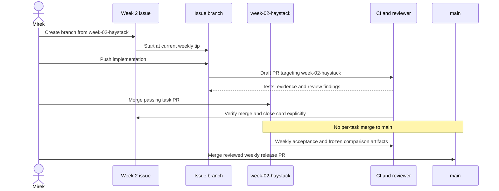

# GitHub learning workflow

Mirek owns production code and design decisions. Copilot or Szpaner adds useful
offline tests and checks evidence; Szpaner maintains explanatory docs and ADRs.
No workflow merges a PR or treats a checked box as a human approval.

## Everyday flow

Week 2 uses a weekly integration branch. See [Week 2 release contract](week-02-release.md)
for its scope, review gates and handoff. The completed Week 1 archive is immutable.

1. Use **Create branch** in an open task issue. Keep its leading number, e.g.
   `82-w02-d1-1-pin-haystack`. Work on one small task per PR, branching from
   current `week-02-haystack` for Week 2; select that source explicitly in the
   GitHub dialog. Do not use the archive branch for ongoing work.
2. Creating the branch at the current base tip does not open an empty PR.
   The first owner push with a commit ahead of its configured integration base creates a **draft PR**.
   The workflow copies the issue's `## Done when` checkboxes and links it with
   `Closes #N` as the final line, including for Week 2. Its base is `week-02-haystack`, not `main`.
   GitHub closing keywords only close issues on the default branch: after a
   weekly task PR is merged and evidence is verified, Szpaner closes its card
   explicitly. A push or a merge alone is not proof of completion.
3. Later owner pushes refresh that PR instead of creating another. Matching
   checked criteria and author text outside the managed block are preserved.
   New criteria start unchecked. Renaming a criterion requires reassessment.
4. CI runs offline Python tests on Linux and Windows with Python 3.12 and 3.13;
   lint/types and Node workflow contract tests run on Linux. Because a PR
   created by `GITHUB_TOKEN` does not trigger another PR workflow, creation
   explicitly dispatches CI on the task branch. Later human pushes use normal PR CI. CI also runs on task PRs targeting
   `week-02-haystack` and on pushes to that integration branch.
5. After CI completes (pass or fail), the agent dispatcher checks that the
   branch/PR head is still that run's commit, belongs to this repository and
   came from the owner. It requests at most one Copilot assessment per head SHA.
   Agent/bot runs do not request another agent, preventing a test-commit loop.
6. Copilot reads the issue, diff and `.github/agents/learning-tests.agent.md`.
   It adds focused tests when they help, reports failures without implementing
   the learner's solution, and updates the PR checklist with evidence. A
   documentation-only commit normally needs an explanation, not new tests.
7. Review the evidence, pull the agent's commits before further local work,
   and mark the draft ready when appropriate. GitHub can require **Approve and
   run workflows** after Copilot pushes. This is a GitHub safeguard; the
   dispatcher does not bypass it. Live experiments and milestone checks remain
   explicit, separate actions. Never infer their completion from mocked tests.

A rapid sequence of pushes can queue follow-up requests while Copilot is still
working. The agent must reassess the latest head and never force-push. Its
checklist assessment remains reviewable evidence, not a deterministic proof.

## Base selection and weekly handoff

`.github/learning-releases.json` lists only prepared weekly integrations and
explicit issue numbers. Week 2 cards #22–#26 and #82–#99 target
`week-02-haystack`; unrelated issues retain the repository default base. The
trusted dispatcher reads this file from the default branch, not from issue text
or the learner's branch. A missing weekly branch is an error, not a reason to
silently send a learning PR to `main`. The agent dispatcher rejects a weekly
PR aimed at the wrong base.

Infrastructure updates to this dispatcher need a separate reviewed PR to `main`;
they do not mark a learning week accepted. Until that PR is merged, select the
weekly base manually rather than relying on the old draft-PR automation.

Do not pre-create later weekly branches or rewrite later cards. At the verified
closeout of the current week, Szpaner prepares **only the next week**: create its
integration branch from the accepted `main` commit, update that week's cards and
the trusted issue/base mapping, and verify CI targets. No workflow auto-merges a
weekly release or accepts it just because an issue was closed.

## One-time setup and current limits

These workflow files must be merged into the default branch before the flow
is active: privileged metadata jobs check out only default-branch scripts and
never execute task-branch code with the dispatch credential.

### Automatic draft PRs

Repository Settings → Actions → General → Workflow permissions must allow
**GitHub Actions to create and approve pull requests**. GitHub combines these
in one setting; this workflow creates PRs, never approval reviews. Keep the
default token read-only: individual jobs declare only their required permissions.
Branch names without a leading issue number, closed issues, PR numbers mistaken
for issues, other users and bot pushes are ignored.

### Copilot test dispatch

Copilot is available for this repository, but the dispatcher needs a GitHub
**user token** with Copilot access. `GITHUB_TOKEN` is not a supported identity
for starting cloud-agent tasks. Do not copy a broad local CLI token into Actions.

Create a fine-grained, expiring personal access token restricted to
`wiertmir/mini-rag`, with the permissions required by GitHub's agent-assignment
API: metadata read, and Actions, Contents, Issues and Pull requests read/write.
Store it directly in the repository's Actions secrets as **`LEARNING_AGENT_TOKEN`**:
[repository Actions secrets](https://github.com/wiertmir/mini-rag/settings/secrets/actions).
The workflow uses it only for GitHub API requests, never exposes it to the
learner branch, and never prints its value. Do not put it in an issue or chat.
Token expiry, Copilot policy/quota and failed assignment must be investigated
if the dispatcher stops; a successful comment alone is not proof the agent ran.

Until that secret is configured, automatic draft PRs and CI work independently;
the test-agent workflow emits an explicit setup warning and does not request work.
No claim of automatic test generation should be made before a live task is seen.

For manual use, assign Copilot to the PR and post a comment such as:

> @copilot Follow `.github/agents/learning-tests.agent.md`. Add meaningful offline
> tests for this commit against the linked issue, without implementing production
> code. Update the managed checklist with evidence and report unverified items.

This uses your signed-in GitHub identity and Copilot quota. It does not require
an Actions secret. Review the session log and resulting test diff.

## Archive and diagrams

The completed plain-Python implementation is preserved in branch
[`week-01-own-implementation`](https://github.com/wiertmir/mini-rag/tree/week-01-own-implementation)
and annotated tag
[`week-01-own-implementation-v1`](https://github.com/wiertmir/mini-rag/tree/week-01-own-implementation-v1).
Both include the README diagrams added before creating either ref. The archive
tag should not move. Local ignored PDFs/indexes are not included; manifests,
configuration and saved result fingerprints describe the experiment.

## Official references

- [Starting and assigning Copilot tasks via the API](https://docs.github.com/en/copilot/how-tos/use-copilot-agents/cloud-agent/use-cloud-agent-via-the-api)
- [Copilot troubleshooting, PR mentions and approval of workflows](https://docs.github.com/en/copilot/how-tos/use-copilot-agents/cloud-agent/troubleshoot-cloud-agent)
- [Events triggered by GITHUB_TOKEN](https://docs.github.com/en/actions/how-tos/writing-workflows/choosing-when-your-workflow-runs/triggering-a-workflow#triggering-a-workflow-from-a-workflow)
- [Automatic token permissions](https://docs.github.com/en/actions/security-for-github-actions/security-guides/automatic-token-authentication)
