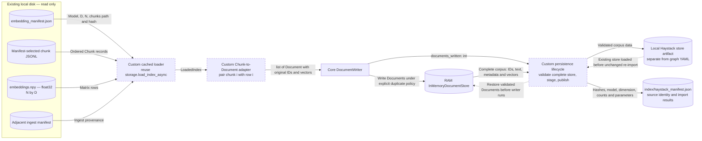
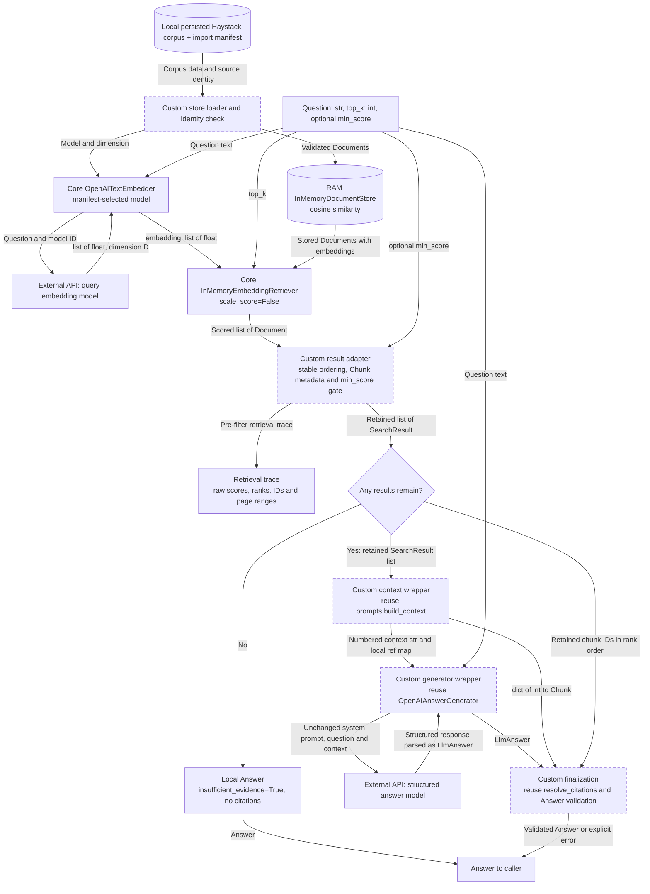
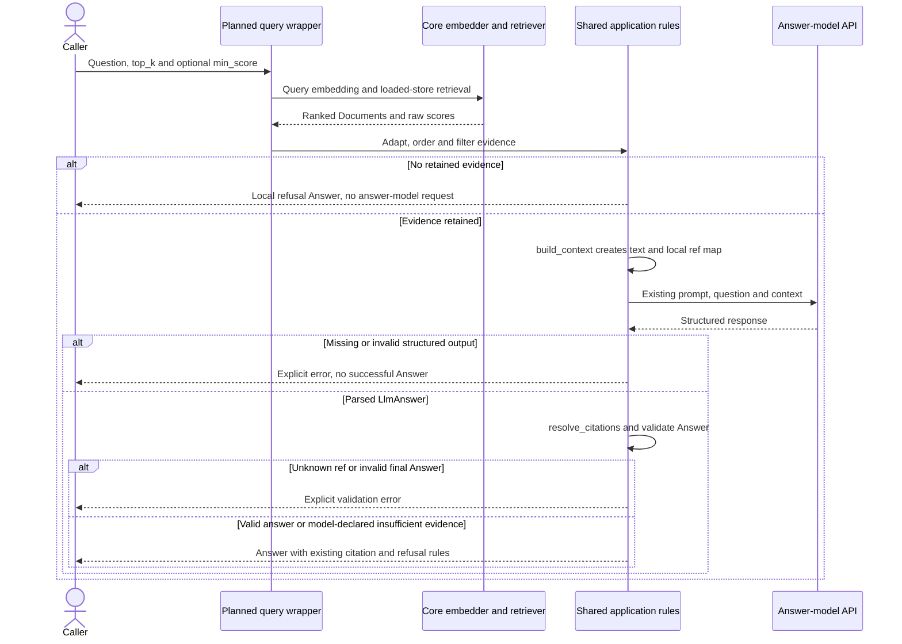

# Planned Haystack pipelines — Week 2

These diagrams record the #85 design accepted by Mirek on 2026-11-28.
**The RAG graphs below are not implemented yet.** The working Day 1 demo only
normalizes text, counts it and round-trips its graph through YAML.
The [component map](haystack-component-map.md) names existing code, typed
boundaries and the native alternatives we are not selecting for the first port.

**Legend:** dashed boxes are planned custom application adapters; solid component
boxes are Haystack core; cylinders are files on local disk or an explicitly
labelled RAM store. No document-embedding API participates in indexing.

## 1. Indexing: import existing chunks and vectors (#86–#90)

The source directory is normally `index/text-embedding-3-small/`; its manifest
selects the chunks file, normally `index/chunks_600_90.jsonl`. The adjacent ingest
manifest is normally `index/ingest_manifest_600_90.json`. Paths are inputs, not
hardcoded assumptions. A bad hash/shape/dtype fails: it never triggers PDF ingest
or document embedding.

On re-import, load and validate the persisted corpus **before** writing into the
store. Verify its identity against the source cache. A changed source follows
the explicit reject/rebuild policy chosen in #88; rebuilding means importing
cached vectors, not generating new embeddings. Write a new corpus artifact only
after complete validation, keeping the previous valid artifact on failure.
The store path/format remains a #88 decision. The success manifest is specified
in #89, not a file already produced by this design task.

## 2. Query: retrieve, decide, generate and validate (#91–#95)

The query graph and indexing graph must use the same loaded corpus and embedding
space. A new `InMemoryDocumentStore` created by loading graph YAML may be empty.
Load the persisted data and validate the manifest before accepting questions.

The store and retriever must expose raw cosine scores, not a rescaled 0–1 value.
Preserve score-descending/chunk-ID-ascending tie ordering at the application
boundary and verify it on tied fixtures; the framework's name alone does not
prove equivalence. The trace exposes retrieval before filtering so discarded
sources are still diagnosable.

An empty retained result list avoids the **answer-model** call, not the query
embedding call. With evidence, the shared generator returns `LlmAnswer`; local
code resolves citations from the reference map and validates the final `Answer`.
It preserves existing diagnostics for mismatched references, rejects unknown
references, and does not accept invented page metadata from the model.

## 3. Refusal and error paths

This sequence expands the decision that must stay visible in the query flow.
The participants are responsibilities, not extra required component classes.

## What #85 proves

This document and the nine-role map record the chosen design. Parsing these
diagrams and checking the source/API links verifies documentation consistency,
not that the RAG graphs run. Later task PRs provide implementation tests and
saved comparison evidence. Do not regenerate the frozen Week 1 baseline or
claim measured parity from this documentation-only PR.
