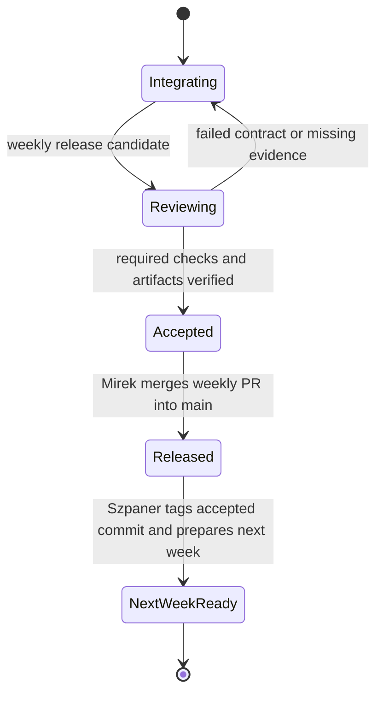

# Week 2: Haystack release contract

## Branches and ownership

| Ref | Purpose | Changes enter through |
| --- | --- | --- |
| `main` | Last accepted learning release, plus reviewed repository infrastructure | Weekly release PR or separate infrastructure PR |
| `week-01-own-implementation-v1` | Immutable plain-Python comparison reference | Never moved |
| `week-02-haystack` | Current Week 2 integration | Reviewed issue PRs |
| `83-...`, `84-...`, etc. | One learning task | Mirek's implementation plus agent-owned tests/docs |
| `week-02-haystack-v1` | Planned immutable release tag, created only after acceptance | Accepted release commit on `main` |

Week 2 starts from commit `f319fdb`, which already includes dependency step #82
and PR #101. This is a historical bootstrap exception, not a claim that Haystack
parity has been released. Do not rewind `main`, move the Week 1 archive, regenerate
baseline measurements or copy ignored PDFs/indexes into Git to change branches.

Mirek owns implementation and decisions. Szpaner owns explanations, diagrams,
ADRs, post-implementation tests, evidence review and card maintenance. No prose
assignment or screenshot is required for machine-verifiable outcomes.

## Task PRs

1. Open the current Week 2 child issue. In **Create branch**, explicitly choose
   **Branch source: `week-02-haystack`** and retain the leading issue number.
2. Fetch and switch to that issue branch. Confirm its starting commit includes
   the latest reviewed weekly changes; do not fork the frozen Week 1 snapshot.
3. Push the implementation. The configured draft PR base is `week-02-haystack`.
   Verify that base in GitHub; while the infrastructure update is pending, open
   or retarget the PR manually before review.
4. Szpaner adds contract tests and updates evidence. CI must pass on the actual
   PR head; local runs must import that head's code, not a different editable install.
5. Mirek merges the reviewed task into `week-02-haystack`. Szpaner verifies the
   merged commit and completion evidence, closes the child explicitly, removes
   its status label and updates its parent. A non-default-base merge does not
   automatically close an issue, even if the body contains `Closes #N`.

Every issue-linked PR description ends with `Closes #N`. The managed body keeps
that single footer last on creation and refresh, preserving author notes and
checked evidence. On a weekly base it is a reference, not an approval or automatic
completion signal; closing keywords only auto-close issues on the default branch.

## Release gate and next-week handoff



Before recommending the weekly merge, Szpaner verifies #22–#25 and their children,
then performs the weekly review #26 against the candidate SHA. This includes the
applicable offline/acceptance checks and real cached-index comparison evidence;
mocked success or skipped data-dependent tests do not establish parity. Preserve
the original Week 1 fingerprints and report limitations of live measurements.

Run workflows against the integration ref explicitly, for example:

```bash
gh workflow run ci.yml --ref week-02-haystack
gh workflow run acceptance.yml --ref week-02-haystack
```

These commands launch checks; neither proves all Week 2 acceptance criteria.
Use #26 for the complete gate and review any missing fixtures or credentials.
Do not launch paid live measurements merely to verify a workflow edit.

The final weekly PR targets `main` and links #26. It must present the candidate
SHA, CI/acceptance runs, comparison artifacts and remaining limitations. Mirek
owns the merge decision. After verifying that merge, Szpaner closes remaining
accepted Week 2 parent/review cards and creates the immutable release tag at the
accepted `main` commit.

At that same closeout, Szpaner automatically prepares **only Week 3**: choose a
branch name matching its actual scope, create it from the accepted `main` commit,
refresh that week's cards/docs and configure its issue/base routing and CI.
Perform the equivalent one-week handoff at later closeouts. Do not create those
branches or rewrite those cards during Week 2. If release evidence is incomplete
or the weekly PR is not merged, retain the blocker and do not start the handoff.

The handoff is an agent procedure, not an unchecked `issues.closed` trigger;
GitHub can close a card without proving its learning contract.
